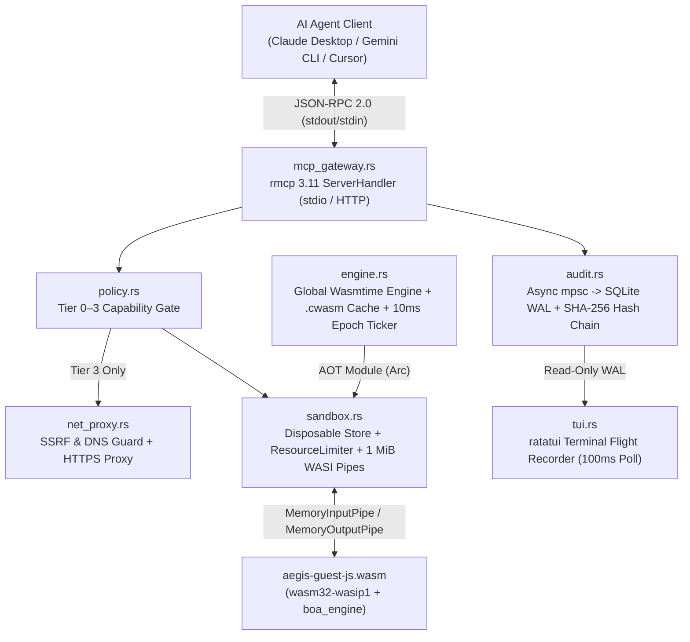
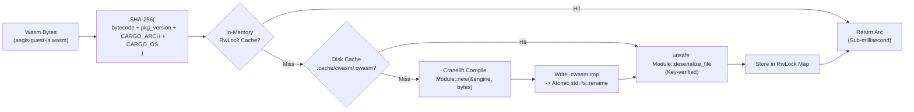
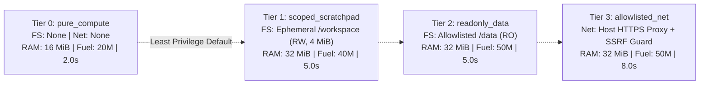
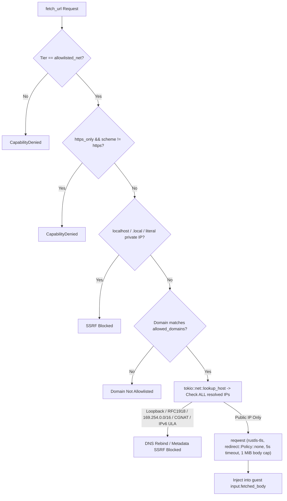
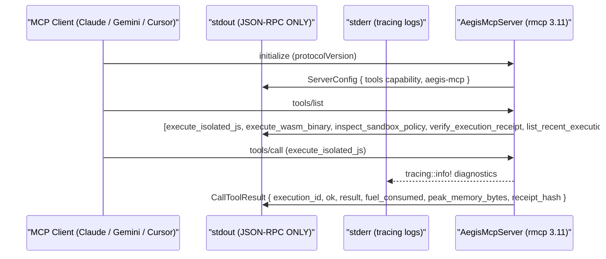

# AegisMCP — Zero-Trust WebAssembly Sandbox Server for AI Agents

AegisMCP is a single-binary, pure-Rust **Model Context Protocol (`rmcp`)** execution server and **live Terminal Flight Recorder (`ratatui`)** backed by Bytecode Alliance's **Wasmtime (`wasmtime` + `wasmtime-wasi`)**, **Boa ECMAScript (`boa_engine`)** compiled to `wasm32-wasip1`, and a tamper-evident **SHA-256 hash-chained SQLite WAL ledger (`rusqlite`)**.

Every untrusted script or `.wasm` payload runs inside a disposable, zero-ambient-authority WebAssembly micro-sandbox with deterministic CPU, wall-clock, memory, filesystem, stdout, and network containment.

---

## Visual Feature Reference (10 Core Security & Runtime Diagrams)

### 1. Zero-Trust Micro-Sandbox Architecture Overview

AegisMCP eliminates host-OS exposure by decoupling the AI agent protocol boundary from untrusted guest execution. No shell subprocesses (`std::process::Command`), Docker daemons, Node.js processes, or host environment variables are ever exposed to guest code.



**Feature Highlights:**
- **Zero Ambient Authority:** `SandboxPolicy::build_wasi_p1` never calls `inherit_env()`, `inherit_network()`, or `inherit_stdio()`.
- **Pure Rust Stack:** Host (`crates/aegis-host`) and guest (`crates/aegis-guest-js`) compile cleanly with zero Python, Node.js, or container runtime dependencies.
- **Disposable Execution State:** Every invocation instantiates a fresh Wasmtime `Store<HostState>` that is dropped immediately after execution.

---

### 2. Sub-5ms AOT `.cwasm` Precompilation & Cache Engine

Cold JIT compilation of a full ECMAScript engine takes noticeable startup time; `engine.rs` eliminates per-call compilation overhead via content-addressed **Ahead-of-Time (AOT)** serialization and an in-memory `RwLock<HashMap<String, Arc<Module>>>` cache.



**Feature Highlights:**
- **Content-Addressed Keys:** Cache keys combine `Sha256(wasm_bytes)`, `CARGO_PKG_VERSION`, `std::env::consts::ARCH`, and `std::env::consts::OS` to prevent stale or cross-architecture artifacts.
- **Atomic Persistence:** `.cwasm.tmp` files are written completely before atomic rename to `.cwasm`, preventing torn reads under concurrent requests.
- **Ahead-of-Time Warmup:** Run `aegis-mcp precompile` or `aegis-mcp doctor` to populate `.cache/cwasm` before serving MCP clients.

---

### 3. Deterministic CPU DoS Protection (Fuel Metering + 10ms Epoch Interruption)

Infinite loops (`while (true) {}`) and exponential CPU traps are neutralized by two independent hardware-agnostic mechanisms working in tandem inside Wasmtime.

```mermaid
sequenceDiagram
    autonext
    participant Ticker as "Background Epoch Ticker (10ms)"
    participant Engine as "Wasmtime Engine"
    participant Store as "Sandbox Store"
    participant Guest as "Wasm Guest (_start)"

    Ticker->>Engine: increment_epoch() every 10ms
    Note over Store: fuel = max_fuel (e.g. 20M)<br/>fuel_async_yield_interval = 100k<br/>epoch_deadline = max_epoch_ticks
    Store->>Guest: call_async(_start)
    loop Every 100,000 Wasm instructions
        Guest-->>Store: Cooperative Async Yield to Tokio
        Ticker->>Engine: Epoch advances (+1)
    end
    alt Fuel Reaches 0
        Guest--xStore: Trap::OutOfFuel
        Store-->>Guest: ExecutionClassification::OutOfFuel
    else Epoch >= max_epoch_ticks
        Guest--xStore: Trap::Interrupt
        Store-->>Guest: ExecutionClassification::EpochTimeout
    end
```

**Feature Highlights:**
- **Instruction Fuel Accounting:** Every executed Wasm instruction decrements the per-`Store` fuel counter; actual `fuel_consumed` is recorded in every audit receipt.
- **Async Cooperative Preemption:** `fuel_async_yield_interval(100_000)` ensures tight loops yield back to the Tokio executor so other MCP calls and the epoch ticker never starve.
- **Exact Trap Classification:** Both `OutOfFuel` and `EpochTimeout` map to structured `ExecutionClassification` values without crashing the host server.

---

### 4. Hard Linear Memory & Table Bomb Guard (`AegisResourceLimiter`)

Guests attempting to exhaust host RAM (e.g., allocating `Uint8Array(1024 * 1024)` in an infinite loop or issuing oversized `memory.grow` instructions) are stopped at the Wasmtime allocator boundary.

```text
+-------------------------------------------------------------------+
|               Wasmtime Store -> AegisResourceLimiter              |
+-------------------------------------------------------------------+
|  Guest executes memory.grow(pages) / allocates JS typed arrays    |
|          │                                                        |
|          ▼                                                        |
|  memory_growing(current, desired, max)                            |
|     ├── desired <= max_memory_bytes ──> Update peak_memory_bytes  |
|     │                                   Return Ok(true)           |
|     └── desired >  max_memory_bytes ──> Set memory_limit_exceeded |
|                                         Return Ok(false) [DENIED] |
|                                                                   |
|  table_growing(current, desired, max)                             |
|     └── Enforce desired <= max_table_elements (10,000 default)    |
+-------------------------------------------------------------------+
```

**Feature Highlights:**
- **Strict Byte Ceiling:** Enforces `16 MiB` (`pure_compute`) or `32 MiB` (`scoped_scratchpad`, `readonly_data`, `allowlisted_net`) linear memory caps.
- **Peak Memory Telemetry:** Records exact `peak_memory_bytes` observed during the run in both the MCP response and SQLite audit ledger.
- **Graceful OOM Catch Protection:** Even if an embedded runtime (`boa_engine`) catches a failed `memory.grow` and exits `0` with a JS allocation error, `sandbox.rs` inspects `limiter.memory_limit_exceeded` and still classifies the run as `MemoryLimitExceeded`.

---

### 5. 4-Tier Capability-Based WASI Security Matrix

AegisMCP follows a strict deny-by-default model configured in `aegis.toml`. Each execution explicitly binds to one of four capability tiers:



| Tier | Config Key | Filesystem Mount | Network Access | Max RAM | Max Fuel | Max Wall-Clock |
|---|---|---|---|---|---|---|
| **Tier 0** | `pure_compute` | None | None | 16 MiB | 20,000,000 | 2,000 ms (200 ticks) |
| **Tier 1** | `scoped_scratchpad` | Ephemeral `TempDir` -> `/workspace` (RW, 4 MiB quota) | None | 32 MiB | 40,000,000 | 5,000 ms (500 ticks) |
| **Tier 2** | `readonly_data` | Validated `readonly_roots` -> `/data` (`DirPerms::READ`, `FilePerms::READ`) | None | 32 MiB | 50,000,000 | 5,000 ms (500 ticks) |
| **Tier 3** | `allowlisted_net` | None | Host HTTPS proxy (`https_only`, `max_response_bytes = 1 MiB`) | 32 MiB | 50,000,000 | 8,000 ms (800 ticks) |

---

### 6. Path Traversal & Scoped Scratchpad Quota Enforcement

Both filesystem-capable tiers (`scoped_scratchpad` and `readonly_data`) reject directory traversal, symlink escapes, and disk exhaustion before and after Wasm execution.

```text
  Untrusted Input Path (e.g. "../../etc/passwd" or "/etc/shadow")
         │
         ├──[Tier 1: validate_scratchpad_relative_path]
         │     ├── Component::ParentDir (..) ──> REJECT (CapabilityDenied)
         │     ├── Component::RootDir (/)    ──> REJECT (CapabilityDenied)
         │     ├── Empty path                ──> REJECT (CapabilityDenied)
         │     └── Pure Normal components    ──> Seed into isolated TempDir (/workspace)
         │                                       Post-run byte walk <= 4 MiB quota
         │
         └──[Tier 2: validate_readonly_mount]
               ├── requested.canonicalize()
               ├── root.canonicalize() (from aegis.toml readonly_roots)
               ├── canon.starts_with(canon_root) == false ──> REJECT (CapabilityDenied)
               └── true ──> Preopen as /data with READ-ONLY WASI descriptors
```

**Feature Highlights:**
- **Zero Host Leakage:** Ephemeral scratchpads live inside `tempfile::TempDir` and are automatically deleted when the request completes.
- **Read-Only Kernel/WASI Descriptor Enforcement:** Attempting `path_open` with `O_CREAT` or `FD_WRITE` inside `/data` fails inside `wasmtime-wasi` with a capability error (`errno != 0`), leaving host files untouched.

---

### 7. SSRF-Hardened Host HTTPS Proxy (`net_proxy.rs`)

Wasm guests never obtain raw TCP/UDP sockets. In Tier 3 (`allowlisted_net`), outbound HTTP GET requests are mediated exclusively by the host's `net_proxy.rs` before the guest executes.



**Feature Highlights:**
- **Blocks Cloud Metadata & Internal Networks:** `is_blocked_ip` rejects `127.0.0.0/8`, `10.0.0.0/8`, `172.16.0.0/12`, `192.168.0.0/16`, `169.254.0.0/16` (AWS/GCP/Azure IMDS), `100.64.0.0/10` (CGNAT), IPv4-mapped IPv6 addresses, and IPv6 ULA/link-local/loopback (`::1`).
- **No Redirect Smuggling:** `reqwest::redirect::Policy::none()` prevents allowlisted domains from redirecting into internal endpoints.
- **Bounded Response Size:** Rejects responses exceeding `max_response_bytes` (`1 MiB` default) via both `Content-Length` pre-check and actual body byte length.

---

### 8. Official Rust MCP Server Gateway (`rmcp` 3.11 over `stdio` & `http`)

`mcp_gateway.rs` implements `rmcp::ServerHandler` with 5 strongly-typed (`schemars` 1.0) MCP tools and strict `stdout` protocol hygiene enforced at compile time via `#![deny(clippy::print_stdout)]`.



**Exposed MCP Tools (`crates/aegis-host/src/mcp_gateway.rs`):**
1. **`execute_isolated_js`** — Evaluates JavaScript inside `aegis-guest-js.wasm` (`boa_engine`) with optional `policy_tier`, `input`, `scratchpad_files`, `readonly_mount_path`, and `fetch_url`.
2. **`execute_wasm_binary`** — Executes any base64-encoded WASI preview1 `.wasm` module with optional `stdin_utf8`, `policy_tier`, and `readonly_mount_path`.
3. **`inspect_sandbox_policy`** — Returns active RAM limits, fuel budgets, epoch deadlines, readonly roots, and SSRF allowlists for one or all tiers.
4. **`verify_execution_receipt`** — Cryptographically verifies a specific `execution_id` receipt and the entire SQLite hash chain.
5. **`list_recent_executions`** — Queries up to `100` recent sandbox executions and security blocks from `audit.db`.

*(Ready-to-use client configs are included in `configs/claude_desktop_config.json`, `configs/gemini_cli_settings.json`, and `configs/cursor_mcp.json`.)*

---

### 9. Tamper-Evident SHA-256 Hash-Chained SQLite WAL Audit Ledger

Every sandbox execution (allowed or blocked) emits a persistent receipt written asynchronously over a bounded `tokio::sync::mpsc` channel to a dedicated SQLite WAL writer thread.

```text
  Genesis Block                        Seq 1                              Seq 2
  prev_hash: 0000...0000  ──────────►  prev_hash: 0000...0000  ─────────► prev_hash: <Seq1 entry_hash>
                                       execution_id + timestamp_utc       execution_id + timestamp_utc
                                       tool_name + policy_tier            tool_name + policy_tier
                                       classification + fuel + mem        classification + fuel + mem
                                       code_sha256 + summary              code_sha256 + summary
                                       entry_hash = SHA256(fields)        entry_hash = SHA256(fields)
                                                                                 │
                                       Tampering ANY column breaks recomputed SHA-256 & all links!
```

**Feature Highlights:**
- **WAL Concurrency:** `PRAGMA journal_mode = WAL; PRAGMA synchronous = NORMAL; PRAGMA busy_timeout = 5000;` enables concurrent reads by `aegis-mcp monitor` while `aegis-mcp serve` writes receipts.
- **Full-Chain Verification:** `aegis-mcp verify` (and the `verify_execution_receipt` MCP tool) walks `ORDER BY seq ASC` from Genesis to tip and pinpoints the exact `broken_at_seq` and `broken_execution_id` on tampering.

---

### 10. Live `ratatui` Terminal Flight Recorder & Red-Team Verification Suite

AegisMCP ships a native Rust terminal observability dashboard (`tui.rs`) and an 8-test hostile integration suite (`tests/red_team.rs`) that exercises real Wasm traps and security boundaries.

```text
+---------------------------------------------------------------------------------------+
| Engine Status: AegisMCP Flight Recorder | DB: audit.db | Runs: 42 | Blocked: 7 | [CHAIN VERIFIED] |
+---------------------------------------------------------+-----------------------------+
| Fuel Consumed (k-units, recent)                         | Latest Sandbox Peak RAM     |
| ▁▂▃█▁▂▁▁▄█▂▁▃▁▁▁▂█                                      | ████░░░░░░░░ 8.00 / 32.00 MiB|
+---------------------------------------------------------+-----------------------------+
| Seq | UTC Timestamp        | Tool                | Tier         | Classification | Fuel  |
|  42 | 2026-11-25T11:20:01Z | execute_isolated_js | pure_compute | OutOfFuel      | 1.5M  |
|  41 | 2026-11-25T11:19:58Z | execute_isolated_js | pure_compute | Success        | 142K  |
+---------------------------------------------------------------------------------------+
| Receipt & Payload Inspector: ID: ... | Code SHA-256: ... | Prev: ... | Hash: ...      |
+---------------------------------------------------------------------------------------+
| Keys: [j/k or Up/Down] Navigate | [f] Toggle Blocked Filter | [v] Verify Chain | [q] Quit |
+---------------------------------------------------------------------------------------+
```

**Red-Team Integration Suite (`crates/aegis-host/tests/red_team.rs`):**
1. `test_cpu_dos_infinite_loop` — Terminates `while (true) {}` via `OutOfFuel` / `EpochTimeout`.
2. `test_memory_bomb_oom` — Halts `Uint8Array(1 MiB)` loop within `16 MiB` RAM cap (`MemoryLimitExceeded`).
3. `test_path_traversal_escape` — Rejects `../../etc/passwd` and `/etc/shadow` with `CapabilityDenied`.
4. `test_secret_exfiltration_env_and_socket` — Proves `environ_sizes_get == 0` and zero JS ambient globals (`process`, `fetch`, `require`).
5. `test_stdout_log_flooding` — Caps 4,000× `console.log` spam cleanly at `max_output_bytes`.
6. `test_readonly_tier_write_blocked` — Confirms WASI `path_open(O_CREAT | FD_WRITE)` fails on `/data` without mutating host files.
7. `test_ssrf_and_domain_allowlist_blocked` — Blocks HTTP, `169.254.169.254`, `127.0.0.1`, `localhost`, `[::1]`, non-allowlisted domains, and Tier 0 network attempts.
8. `test_audit_hash_chain_tamper_detection` — Mutates row 2 directly in SQLite and verifies `verify_sqlite_chain` detects `broken_at_seq == Some(2)`.

---

## Build & Run

```bash
# 1. Build guest Wasm (wasm32-wasip1), run Clippy (-D warnings), build release host, and run all tests
chmod +x scripts/build_all.sh
./scripts/build_all.sh

# 2. Precompile .wasm -> .cwasm AOT cache and run diagnostics
./target/release/aegis-mcp --config aegis.toml precompile
./target/release/aegis-mcp --config aegis.toml doctor

# 3. Start headless MCP server (pure JSON-RPC on stdout; diagnostics on stderr)
./target/release/aegis-mcp --config aegis.toml serve

# 4. Launch live Terminal Flight Recorder in another terminal
./target/release/aegis-mcp --config aegis.toml monitor --refresh-ms 100

# 5. Verify SHA-256 hash chain integrity in SQLite WAL
./target/release/aegis-mcp --config aegis.toml verify
```
